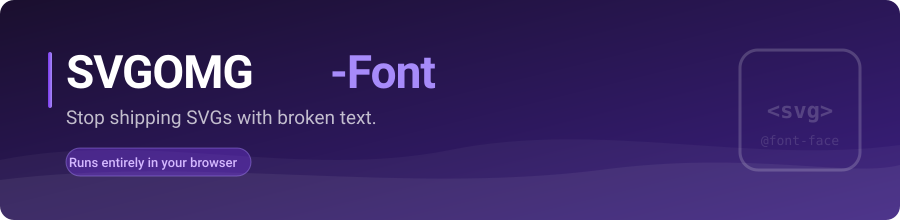

# SVGOMG-Font

**[Try it live →](https://www.allaboutken.com/svgomg-font/)**

Drop in an SVG that references fonts by name. Get back an SVG with the font
files embedded as base64 data URIs, so the fonts travel with the image —
including when a browser displays it in an `` tag.

Processing happens in your browser: your SVG and supplied font files aren't
uploaded. Automatic font lookup downloads files from
[Fontsource](https://fontsource.org/) via jsDelivr, so it needs a network
connection. No backend, no account.

> A companion to [SVGOMG](https://jakearchibald.github.io/svgomg/), which is
> great at optimizing SVGs but doesn't touch fonts.

## Usage

1. Open the **[live app](https://www.allaboutken.com/svgomg-font/)** and choose
   **Roboto card** under **Or try a sample**, or use **Choose file**, drag an
   SVG onto the page, or **Paste SVG**.
2. Processing starts automatically. Compare **Before** and **After**, and
   read the report for missing fonts or assumed weights.
3. Adjust **Options** if needed. Changing embedding, stripping, subsetting,
   or optimization reprocesses the original SVG. **Embed fonts**,
   **Strip ``**, and **Subset glyphs** start enabled;
   **Optimize (SVGO)** starts disabled. **Background** only changes the canvas.
4. Resolve any missing fonts below, then choose **Download fixed SVG** or
   **Copy SVG**. File downloads use the original name plus `-embedded.svg`.
   Check the downloaded file in its intended viewer before sharing it.

### If a font is missing

When Fontsource can't resolve a family, the app tries installed-font access
where `queryLocalFonts` is available. Allow the browser's local-font permission
if prompted. If access is blocked, **Detect installed fonts** or **Retry font
detection** lets you try again; the browser may require changing its site
permission first.

You can also use **Upload font** for each missing family, weight, and style,
or drop a font file onto its row. Accepted formats are `.woff2`, `.woff`,
`.ttf`, and `.otf`; processing runs again after upload. This is also the
fallback when installed-font access isn't available. Only embed fonts whose
licenses permit embedding and redistribution; the app does not verify rights.

A correct preview on your machine doesn't prove the font was embedded: your
browser may be using an installed copy. Check the report for missing faces.
A download can still be offered when some faces are unresolved.

To run locally, follow [Local setup](CONTRIBUTING.md#local-setup).

## The problem

Design tools can export SVGs that reference fonts by name —
`font-family: Roboto-Bold` — without embedding them. Others emit deprecated
SVG `` glyph blocks. The file looks fine in your editor but loses the
intended text appearance elsewhere.

SVGOMG-Font resolves fonts, optionally strips deprecated blocks, and inserts
`@font-face` rules in the SVG's `<style>`. Optional SVGO optimization keeps
`inlineStyles` and `minifyStyles` disabled to protect those embedded rules.
See [ABOUT.md](ABOUT.md) for background.

## Why embedding beats outlining

Outlining converts text to paths. Embedding keeps real `<text>` nodes editable
and machine-readable, and can be smaller for text-heavy SVGs. Size depends on
the fonts and text; base64 adds roughly one third to the raw font payload.
An SVG used as an `` still needs appropriate `alt` text in the host page.
Email clients and other viewers may restrict SVG or embedded fonts, so test
the destination rather than assuming browser support carries over.

## Samples

The UI loads examples from [public/samples/](public/samples/). **Roboto card**
includes a deprecated `` block. **Helvetica Neue report** and **Optima
quote** exercise missing-font handling; availability on your device varies.

## Limitations

- Font lookup runs before installed-font or upload fallback. A network error
  can stop processing; restore CDN access and reload the SVG before retrying.
- Automatic lookup requests Fontsource's `latin` WOFF2 file, falling back to
  `latin-ext` only if that request fails. It doesn't choose a subset based on
  your text. For other scripts, supply a font containing the required glyphs.
- Automatic lookup infers weight and italic style from family-name suffixes
  (`Roboto-Bold`, `Roboto-Italic`). A bare `Roboto` resolves to weight 400;
  separate `font-weight` and `font-style` declarations don't drive CDN lookup.
  Check the result, especially for SVGs using several weights of one family.
- **Subset glyphs** attempts to keep characters used in SVG text plus Basic
  Latin (U+0020–U+007E). A smaller successful subset is embedded as TrueType;
  otherwise the original font is kept. Turn this off if you plan to edit the
  text later with characters outside that set. Subsetting cannot add glyphs
  missing from the source font.
- Embedding fonts doesn't embed other external resources, such as linked images.

## Stack

- [Vite](https://vitejs.dev/) — dev server + bundler
- [SVGO](https://svgo.dev/) — optional optimization pass
- [fontkit](https://github.com/foliojs/fontkit) — optional glyph subsetting
- Vanilla JS, no framework

## Contributing

See [CONTRIBUTING.md](CONTRIBUTING.md) for setup, checks, and contribution rules.
Conventional Commits, small PRs. [CHANGELOG.md](CHANGELOG.md) records releases.

## License

MIT — see [LICENSE](LICENSE). Font files retain their own license terms.
